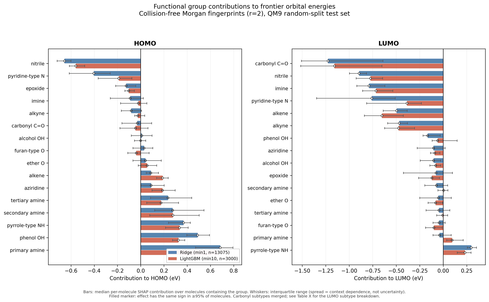

# HOMO/LUMO prediction from SMILES with collision-free Morgan fingerprints

Master's thesis project, Faculty of Chemistry, Brno University of Technology.

Predicts frontier orbital energies from molecular structure and quantifies how
individual functional groups shift them, using collision-free Morgan fingerprints
and SHAP attribution.

Full writeup: [HOMO_LUMO_CFMF_report.md](HOMO_LUMO_CFMF_report.md)

## Results

Test MAE (eV) on QM9, random split (130,741 molecules):

| model | features | HOMO | LUMO |
|---|---|---|---|
| mean predictor | — | 0.440 | 1.051 |
| Random Forest | 162 RDKit descriptors | 0.121 | 0.125 |
| Ridge | CF-MF (r=2, counts) | 0.118 | 0.143 |
| LightGBM | CF-MF (r=2, counts) | **0.098** | **0.094** |

## Reproducing

1. Download `qm9.csv` and `uncharacterized.txt` from the
   [QM9 figshare collection](https://figshare.com/collections/Quantum_chemistry_structures_and_properties_of_134_kilo_molecules/978904).
   Put `qm9.csv` in the project root and `uncharacterized.txt` in `data/`.
2. `pip install -r requirements.txt` (Python 3.14)
3. Run the numbered scripts in order, `01_audit.py` through `16_outputs.py`.

Roughly 4 h total on an M-series MacBook Air. The long steps are `05c` (tuning),
`06a` (final models), `13` (validation) and `15` (descriptor SHAP).

Trained models and intermediate matrices are not versioned — they regenerate
from the scripts.